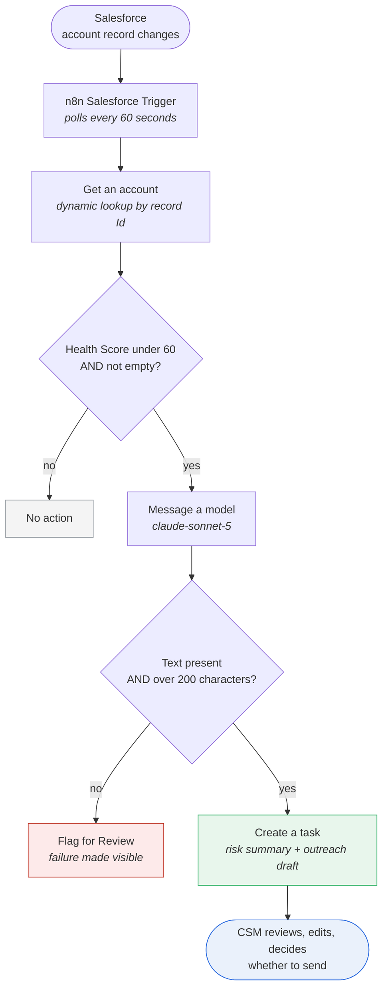
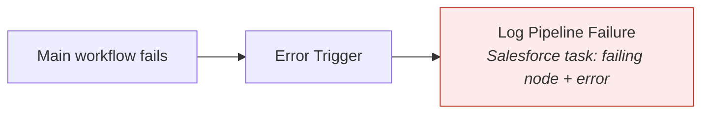

# MarketSync Pro

**Scores a whole book of accounts, flags the ones at risk, and drafts the outreach. The CSM decides what gets sent.**

Salesforce, n8n and the Claude API. A scan of 18 accounts ran in 1 minute 38 seconds, against an estimated 54 to 84 minutes of doing the same work by hand.

**Six minute walkthrough: https://youtu.be/AlRQ2WnhPAw**

> All account data here is synthetic. Every record is labelled "Test Portfolio" and says in its own description that it is not a real customer. No real customer data was used at any point.

---

## The problem this answers

The question a Customer Success hiring manager actually asks is this:

> "I have eighty accounts and I cannot personally look at all of them. What would you do?"

A risk summary for one account does not answer that question. A ranked view across a whole portfolio, with the top accounts flagged and the reason for each score visible, does.

So this project is built around three things a scaled CS team needs:

1. A score that can be explained to a customer, not a black box number
2. A ranked list so the day starts with the right five accounts
3. A draft that saves writing time without taking the decision away from the CSM

---

## How it works



Nothing reaches a customer from this diagram. The last box is a person.

### When the pipeline itself dies

A second workflow, **MarketSync Error Handler**, is wired as the error workflow for the main one. If the run fails before it reaches any of the checks above, the failure is written into Salesforce instead of staying buried in a log nobody opens.



---

## The scoring model

Health Score is a Salesforce **formula field**, not a number somebody types in. It cannot be edited by hand, which means it cannot drift away from its own definition.

```
Health Score = (Adoption x 0.45) + (Engagement x 0.35) + (Payment x 0.20)
```

| Component | Weight | What it measures |
|---|---|---|
| Adoption | 45 percent | Is the product actually being used |
| Engagement | 35 percent | Is the relationship with the vendor alive |
| Payment | 20 percent | Is the commercial relationship healthy |

Adoption carries the most weight because this model treats product usage as the leading signal, and payment carries the least because an invoice reflects a decision that was already taken. That is the reasoning behind the split, not a finding. The weights and the threshold of 60 are starting hypotheses. Validating them would need real churn outcomes to test against, and this project does not have any.

Blank handling is set to **treat blank fields as blanks**. If a component is missing, the score stays empty rather than collapsing to zero. This matters, and the reason is in the bug list below.

### Reading a score

The score tells you how much is left. To find the cause, look at how many points each component lost:

```
Points lost by a component = (100 - component score) x weight
```

Brightline Telecom, Health Score 31:

| Component | Score | Points lost | |
|---|---|---|---|
| Adoption | 24 | 34.2 | largest driver |
| Engagement | 36 | 22.4 | |
| Payment | 38 | 12.4 | |

Sixty nine points lost in total, and thirty four of them came from Adoption alone. That is the answer, and it is the answer because of both the low score and the heavy weight. It is not always adoption. An account with Adoption 90, Engagement 20 and Payment 50 loses 4.5, 28 and 10 points, so engagement is the driver there despite the lighter weight.

This calculation is also given to the model, which is why the generated summaries name the driver and quote the number instead of saying "usage appears low".

---

## The test portfolio

19 synthetic accounts, spread deliberately rather than randomly:

| Band | Count | Scores |
|---|---|---|
| Healthy | 5 | 82 to 93 |
| Mid range | 5 | 63 to 74 |
| Sitting on the boundary | 2 | 60 and 61 |
| At risk | 6 | 31 to 59 |
| Deliberately incomplete | 1 | no component scores at all |

That is 19 records, of which 18 carry a score. The incomplete one has no components, so the formula leaves its health score empty rather than quietly calculating a zero.

The at risk threshold is `Health Score < 60`, so three accounts sit on the boundary on purpose:

| Account | Score | Expected | Why |
|---|---|---|---|
| Redstone Capital Partners | 59 | flags | one point below the threshold |
| Sterling Grove Hospitality | 60 | does not flag | the condition is "less than", not "less than or equal to" |
| Juniper Software Labs | 61 | does not flag | one point above |
| Halcyon Robotics | blank | does not flag | no data is not the same as a bad score |

Running the portfolio produced exactly six alerts, and Sterling Grove and Juniper were correctly left alone.

Halcyon is a slightly different case and worth being precise about. It was not part of that run at all, because the list view used to trigger the run filters on a score being present. Its purpose is to prove that the formula leaves a record with missing components empty rather than scoring it zero. The workflow side of the same guard, the "is not empty" condition, was verified separately against another blank scored account, which was correctly routed away from the alert path.

---

## Error handling

The failure mode that worries me in an AI pipeline is not the loud one. It is the run that reports success while writing something wrong. Three of the bugs below were exactly that, so the error handling is built around catching silence.

**Retries.** The three API nodes retry three times with a two second gap. During one afternoon of testing, the Salesforce trigger failed six times in two hours because the connection dropped. Without retries a momentary network blip kills a whole scan, and nobody is told. Retrying also keeps a brief outage from becoming an alert, which matters because alerts that fire for nothing get ignored.

**Output validation.** Before anything is written to Salesforce, the generated text has to be present and longer than 200 characters. That catches an empty response and an unusually short one. It does not prove the text is complete or factually correct, and it is not meant to. It is a floor, not a guarantee, which is one more reason a person reads every draft before anything goes out.

**Visible failure.** When validation fails, the workflow does not quietly skip the account. It creates a different Salesforce task, linked to that account, stating what happened and what to do about it.

**Pipeline failure logging.** If the workflow dies before reaching any of this, the separate error handler workflow writes a task naming the node that broke and the error returned.

Both paths were tested by forcing them to fail, not by assuming they work. Max tokens was temporarily dropped to 300 to force a truncated response, and the account lookup was temporarily pointed at an invalid record Id to kill the pipeline. Both produced the expected task.

---

## What broke, and how it was found

This section is the honest part of the project, and the part I would most want to talk through in an interview. Every one of these was found by opening the output and reading it, not by looking at a status indicator.

**1. A hardcoded account Id.** The original build fetched one specific account every single run. It looked like it worked because the demo account was the only one ever tested. Replaced with a dynamic lookup driven by the triggering record.

**2. Null scored as zero.** An account with a blank health score passed the "less than 60" check, because a blank coerces to 0 and 0 is less than 60. The account with no data at all was being treated as the most at risk account in the book. Fixed twice over: an "is not empty" condition in the workflow, and blank handling on the formula field so the score stays empty rather than becoming 0.

**3. A number that was a string.** The threshold value 60 was being evaluated as text, so the comparison failed with a type error. n8n offers a "convert types where required" switch that makes this go away. I did not use it. A switch that hides type errors will hide the next one too, and the next one may not announce itself.

**4. The model read a bad NPS as a good one.** `NPS_Score__c` holds an account level NPS index on the standard scale of minus 100 to plus 100, where anything under 30 is weak. The prompt passed the number without saying any of that, so the model read an NPS of 8 as a 0 to 10 survey rating from a satisfied customer and wrote that the account had "high sentiment". The output was fluent, confident and the opposite of true. Fixed by stating the scale and the healthy threshold in the prompt. The lesson is that an ambiguous field is a bug in the prompt, not in the model, so the documentation of that field should not be ambiguous either.

**5. An empty task that reported success.** The model response began returning a thinking block as the first element, so the expression reading `content[0].text` returned undefined. n8n reported success. Salesforce reported success. The task was created with a completely empty description. Fixed by selecting the block whose type is `text` rather than trusting its position, so the pipeline survives the response shape changing again.

**6. An email that stopped mid sentence.** The token limit was too low, and the thinking block was consuming part of that budget. The generated email ended halfway through a sentence with no closing and no signature. Again, every status said success. Fixed by raising the limit, and guarded by the length check in the validation node.

The pattern across four of these six is the same: the system said it worked, and it had not. That is the argument for the validation node and for reading output rather than trusting status.

---

## Impact

The automated run time is measured. The manual time is an estimate, built from three timed account reviews and scaled across the portfolio. Both are labelled below, because the difference between the two is exactly the kind of thing this project is supposed to be careful about.

I timed myself doing the same work by hand, with no AI, on three accounts.

| Task | Time |
|---|---|
| At risk account: score, diagnose, write summary, write outreach email | 11 minutes |
| Healthy account: score and decide | 2 minutes |
| Boundary account: score and decide | 1 minute |

Applied to the portfolio of 18 scored accounts, 6 of which are at risk:

| | Time for 18 accounts | |
|---|---|---|
| By hand, first time doing it | 84 minutes | estimated |
| By hand, allowing for practice | around 54 minutes | estimated |
| MarketSync Pro | 1 minute 38 seconds | measured |

That is roughly 33 to 51 times faster depending on which manual baseline you accept. Both are given because the first attempt at anything is slow, and quoting only the flattering number would be the wrong habit for a project whose whole point is honest measurement.

Two things that comparison deliberately does not include. The 1 minute 38 seconds covers generation only, not the time a CSM then spends reading and editing the drafts, so it is not an end to end productivity figure. And the manual number was scaled from three timed reviews rather than measured across all 18 accounts.

**How the benchmark run was triggered.** The workflow is event driven, not a scheduled bulk scan. To put the whole portfolio through it at once, all 18 scored accounts were updated together with a single field edit from a Salesforce list view. The polling trigger then picked them up as 18 changed records in one cycle, which is the run timed above. A scheduled portfolio digest would be the cleaner design for this and is listed under next phase.

The second number matters more than the speed:

| | Time from the data changing to the account being flagged |
|---|---|
| Weekly manual portfolio review | around 3.5 days on average |
| MarketSync Pro | under 2 minutes |

Speed saves an afternoon. Detection latency is what decides whether the conversation happens while the account can still be saved.

---

## Human in the loop

The AI writes. It never sends.

Every generated summary and email lands in Salesforce as a task with status **Not Started**, assigned to a person. The CSM opens it, reads it, edits it, decides whether to send it, and marks it complete themselves. The outreach drafts contain square bracket placeholders rather than invented names, dates or claims, because a draft that quietly fabricates a detail is worse than no draft at all.

This is a design decision, not a limitation. Judgement about a customer relationship belongs to the person who owns that relationship.

---

## Stack

| Layer | Tool |
|---|---|
| CRM and data model | Salesforce Developer Edition: custom fields, a formula field, a record triggered Flow, custom list views |
| Automation | n8n, self hosted with Docker on WSL2 |
| Generation | Claude API, `claude-sonnet-5`, called through n8n's Anthropic node |

n8n is self hosted rather than running on the hosted plan. That was originally forced by a trial expiring, but it turned out to be worth doing properly, since it meant dealing with Docker, WSL2, persistent volumes and OAuth callbacks rather than clicking through a managed setup.

---

## What this is not

Worth stating plainly, because a portfolio project that claims too much is easy to take apart.

- The data is synthetic. The scoring logic is real, the accounts are not.
- The weights are a reasoned starting point, not a validated model. Validating them would need real churn outcomes to test against.
- The scoring is deterministic by design. The AI writes the narrative, it does not decide the score. That keeps the number defensible.
- Only structured Salesforce fields are read. Support tickets, email threads and call notes are the obvious next signals and are not in scope here.

### Next phase

- Pull unstructured signals (ticket text, email threads, call notes) into the risk picture
- Validate the weights against real churn outcomes rather than judgement
- Replace per record polling with a scheduled portfolio digest

---

## Why I built this

I bring client delivery and onboarding experience, supported by hands on Salesforce and AI workflow automation. I built a prototype that prioritises account risk, creates reviewable outreach drafts, and makes workflow failures visible.
